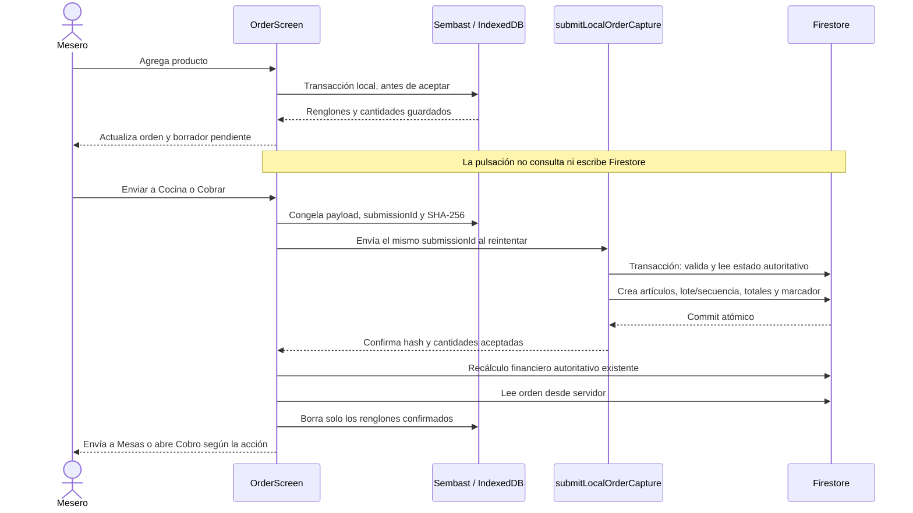

# Captura local persistente y envío atómico V1

## Protocolo

Un error de red, permiso, estado terminal, validación o recálculo conserva el borrador congelado. Reintentar no cambia el payload ni el identificador. El borrador solo se borra después del resultado idempotente del servidor, el recálculo existente y la lectura de servidor.

## Persistencia local

Base de datos Sembast durable en Android/iOS/escritorio y Sembast sobre IndexedDB en web; el adaptador de pruebas no usa red. Cada renglón incluye versión de esquema, restaurante, sucursal, orden y mesa/grupo, UID del dispositivo, empleado/persona, producto, cantidad, precio aplicado, plataforma, notas, receta/preparación y hora de captura. La clave local identifica el renglón; el payload congelado incluye todos los campos y el SHA-256.

Las líneas se agrupan localmente solo por dispositivo, empleado, persona, producto y plataforma. Un envío completado elimina sus IDs locales; una captura posterior recibe IDs nuevos. Las líneas remotas confirmadas se combinan con el borrador sin reemplazarlas.

## Atomicidad e idempotencia

- `submitLocalOrderCapture` es una callable de `us-central1`, con Auth y App Check obligatorios; App Check consume el token de uso limitado.
- El marcador `activityLog/capture_submission_{submissionId}` vincula UID, orden, sucursal, hash, modo Cocina y resultado. Mismo ID/contenido devuelve el resultado guardado; contenido, modo u propietario distintos se rechazan.
- La transacción valida dispositivo, empleado y sucursal; orden no terminal; precios y producto actuales; stockout; pagos, artículos y mesas vinculadas. Después crea artículos, ajusta agregados, Cocina/secuencia/lote y marcador en la misma transacción.
- No usa IDs de artículos del cliente como IDs de Firestore. No reemplaza el contenido de la orden.
- Límite preventivo: 350 líneas, 700 KB UTF-8 y máximo estimado de 450 escrituras. El error conserva el borrador; no hay envío parcial.
- Para artículos que no requieren Cocina, el servidor los crea con `kitchenStatus: not_required`, agrega su precio al total y no crea lote de Cocina.

## Compatibilidad y activación

| Escritor/cliente | Comportamiento | Compatibilidad y límite |
|---|---|---|
| Android con esta implementación | Captura nueva local; envío por callable | Requiere desplegar la callable antes de distribuir la app. |
| Android +31 o anterior | Conserva el protocolo directo existente | No escribe los renglones locales nuevos. El envío V1 usa IDs aleatorios y transacciones; un dispositivo antiguo puede seguir agregando sus propios artículos por la ruta anterior. No se debe interpretar la instalación de V1 como retiro de APK antiguos. |
| Cocina y Mesas actuales | Leen documentos de orden/artículos y campos de lote existentes | No requieren cambios de contrato ni filtros. |
| Backoffice actual | Sin cambios de código ni ruta de captura | No se añade campo obligatorio a documentos históricos ni se ejecuta migración. |
| Órdenes históricas | Se valida el documento existente y el predicado de estado portado; se leen todos sus artículos/pagos | No depende de fecha, nuevos campos ni migración histórica. |

Rules desplegadas revisadas previamente son permisivas para las escrituras existentes; la callable usa Admin SDK y no depende de una regla nueva. No se modificaron Rules ni índices. Las Rules locales completas se probaron en Emulator. Las escrituras heredadas siguen habilitadas durante la transición: un APK viejo no puede enviar un renglón local que nunca recibió, pero la exclusión criptográfica de todo cliente antiguo requiere una política de versión/Rules de servidor futura y una etapa separada. El servidor no puede conocer borradores que siguen completamente offline en otra tablet.

### Activación gradual

1. Revisar este cambio y verificar App Check para la app Android de producción.
2. Desplegar primero únicamente la callable desde un proyecto de prueba y validar el mismo protocolo en Emulator. No ejecutar backfill ni migración: V1 no la necesita.
3. Distribuir en pista interna una APK/AAB con un `versionCode` confirmado libre en Play Console; el número todavía no se cambia en este worktree.
4. Probar una tablet con almacenamiento persistente, red interrumpida, reintento y envío a Cocina/Cobro; confirmar la misma cantidad y un único lote.
5. Expandir por sucursal y revisar métricas locales/remotas antes de decidir si se hace obligatoria.

## Política operativa y borradores pendientes

El servidor no puede descubrir una captura que todavía existe únicamente en el almacenamiento local de otra tablet. Durante pérdida de conectividad, no se debe tratar la vista del servidor como prueba de que todas las capturas fueron recibidas. La política de operación para la prueba controlada es:

1. Asignar una sola tablet/mesero como capturista de una orden mientras esa orden esté trabajando sin conectividad estable.
2. No cobrar ni cerrar una orden hasta que todos los dispositivos que pudieron capturarla hayan vuelto a conectarse, hayan abierto la orden y no muestren capturas locales o envíos pendientes.
3. Si una tablet presenta un borrador pendiente o un envío de resultado incierto, reintentar el mismo `submissionId` desde esa tablet. No borrar los datos de la app, reinstalarla ni volver a capturar esos renglones en otro dispositivo.
4. Si una orden desaparece de Mesas mientras conserva datos locales en una tablet, detener su cobro y solicitar recuperación desde esa misma tablet y orden. No crear automáticamente otra orden ni trasladar renglones a una orden distinta.

Esta política no sincroniza borradores offline entre dispositivos. La herramienta de inventario/recuperación de borradores huérfanos todavía no existe y es un pendiente P1-08: una orden ausente de Mesas sin acceso a su pantalla no tiene una ruta de soporte dentro de la aplicación. Debe resolverse antes de declarar la captura offline operativamente completa. Clientes Android anteriores y Backoffice pueden seguir escribiendo por sus rutas existentes; no se asume que la instalación de la nueva versión los haya retirado.

## Métricas

Cada pulsación registra `persistenceMs`, `remoteReads=0` y `remoteWrites=0`. La callable devuelve `serverElapsedMs`, intentos, consultas de colección, documentos leídos y operaciones escritas. El cliente registra la duración del recálculo/lectura de servidor y duración total. Las lecturas de conciliación posteriores se miden por separado; no se suman a las lecturas que reporta la callable. Los contadores no son bytes transferidos. Para medir bytes se necesita medición de red Android por paquete durante una prueba física.

## Reversión y recuperación

- Si la callable falla antes del commit, los registros locales permanecen y pueden reintentarse.
- Si el commit ocurrió y la respuesta se perdió, repetir el mismo ID devuelve el mismo resultado; no crea artículos ni lotes nuevos.
- No borrar datos de la app ni reinstalar una versión antigua mientras existan borradores locales. La versión +31 no conoce la base Sembast; primero confirmar los borradores mediante V1 o exportarlos/recuperarlos con una herramienta de soporte aprobada.
- Para retirar el cliente, detener primero nuevas instalaciones y conservar la callable. No deshabilitar la callable mientras existan submissions pendientes; hacerlo volvería irrecuperables sus reintentos hasta reactivarla.
- No se cambia ninguna fórmula financiera; el flujo ejecuta el recálculo autoritativo existente antes de borrar el outbox o abrir Cobro.

## Limitaciones de validación

Los tests Dart verifican persistencia durable mediante cierre/reapertura de la base, borrador y UI. Los tests TypeScript ejecutan la transacción Admin SDK contra Firestore Emulator. La suite de Rules también corre contra Emulator. No se probó todavía Flutter Android conectado al emulador ni una tablet física; esa prueba es requisito antes de cualquier publicación. No se escribió ni desplegó nada en producción.
